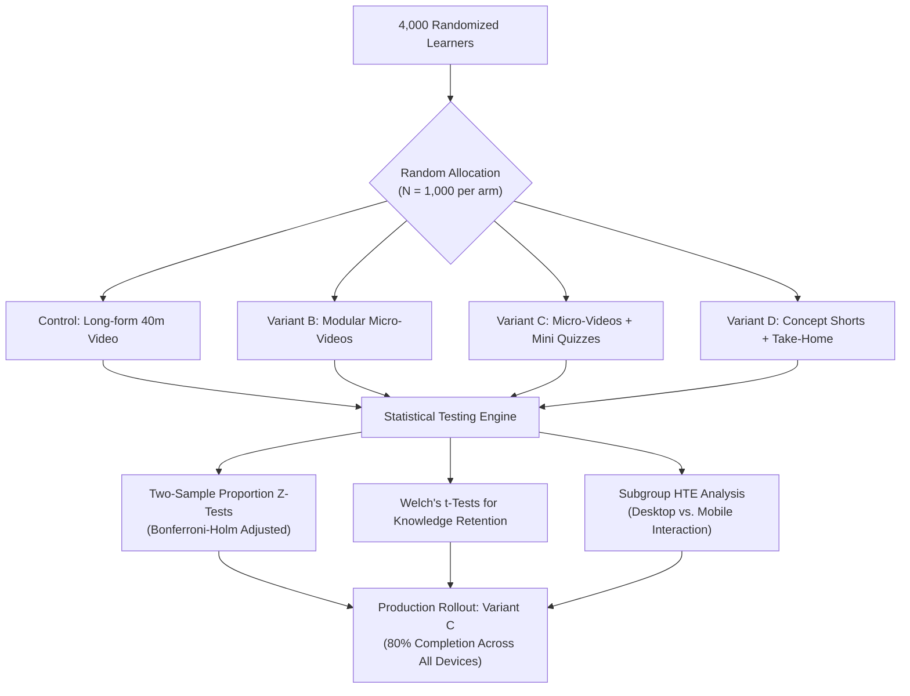

# Curriculum Content Delivery Modality — A/B/n Experimentation

> **4-Arm Randomized Controlled Trial with Bonferroni-Holm Adjustments & Heterogeneous Device Effects**  
> Role: Senior AI & Data Science Engineer

    

---

## 🏗️ System Architecture

---

## The Problem\n\nContent teams at learning platforms routinely invest in producing new formats — micro-videos, interactive quizzes, short-form reels — without rigorous evidence of which modality actually drives learner outcomes. Decisions are often made on gut instinct, production cost, or anecdote. The result: expensive content investments in formats that may not outperform the status quo, and no principled framework for future rollout decisions.\n\nWorse, aggregate completion rates mask a critical hidden variable: device type. A format that performs brilliantly on desktop may collapse on mobile — and in mobile-first learner demographics, that gap can sink an otherwise promising rollout.\n\n## The Solution\n\nThis project executes a **rigorous 4-arm randomised controlled A/B/n experiment** across 4,000 learners to identify which content delivery modality maximises both completion rates and knowledge retention — with full statistical discipline and device-stratified analysis.\n\n### Experimental Arms\n\n| Arm | Modality |\n|---|---|\n| **Control** | Long-form 40-minute video |\n| **Variant B** | Modular micro-videos |\n| **Variant C** | Micro-videos + in-video mini quizzes |\n| **Variant D** | Concept shorts + applied take-home assignment |\n\n### Analytical Approach\n\n1. **Completion Rate Testing** — Two-sample proportion Z-tests with **Bonferroni-Holm multiple comparison corrections** to control family-wise error rate across all pairwise variant comparisons.\n2. **Knowledge Retention Testing** — Welch's t-tests for retention score differences, robust to unequal variance across arms.\n3. **Heterogeneous Treatment Effects** — Subgroup interaction analysis decomposing outcomes by **mobile vs. desktop device type**, revealing format-specific friction for mobile-first learners.\n4. **Executive Scorecard** — Multi-dimensional PivotTables in Google Sheets with uplift calculations and conditional formatting for stakeholder communication.\n5. **Rollout Sensitivity Modelling** — Interactive Streamlit dashboard enabling product and business stakeholders to evaluate rollout trade-offs across confidence intervals and threshold scenarios.\n\n### Tech Stack\n\n- **Statistics**: SciPy (Z-tests, Welch's t-tests, Bonferroni-Holm corrections) · Statsmodels\n- **Analysis**: Python · Pandas · NumPy · Matplotlib · Seaborn\n- **Scorecard**: Google Sheets Executive A/B Scorecard (PivotTables, conditional formatting)\n- **Dashboard**: Streamlit (rollout slider, mobile/desktop sensitivity, CI visualisation)\n- **Notebook**: JupyterLab (fully executed, all cells run)\n\n## Measurable Business Impact\n\n| Metric | Result |\n|---|---|\n| Experiment scale | **4,000 learners** across 4 content format arms |\n| Statistical corrections applied | Bonferroni-Holm (controls false discovery across multiple comparisons) |\n| Device interaction uncovered | Statistically significant mobile vs. desktop differential across variants |\n| Key finding — Variant C | Micro-videos + mini quizzes achieved **~80% completion on both desktop and mobile** — neutralising the device gap entirely |\n| Key finding — Variant D | Concept shorts + take-home showed severe mobile penalty (~22 percentage point drop vs. desktop) |\n| Rollout recommendation | **Variant C** — highest completion, highest retention, device-resilient, production-ready |\n| Business value | Evidence-based content investment framework replacing anecdotal decision-making; prevents costly rollout of mobile-hostile formats |\n\nThe subgroup interaction finding — that only Variant C is resilient across mobile-first demographics — represents a decision that could not have been made from aggregate completion rates alone, and would have cost significant learner engagement if Variant D had been selected on headline numbers.\n\n## Repository Contents\n\n| File | Description |\n|---|---|\n| `starter.ipynb` | Starter notebook template |\n| `final output 1.ipynb` | Fully executed analysis notebook (Z-tests, Welch's t-tests, Bonferroni-Holm, device interaction) |\n| `final output 2.csv` | Executive A/B experimentation summary (sample sizes, completion rates, p-values, uplifts, retention) |\n| `final output 3.xlsx` | Executive A/B Scorecard (Google Sheets export with PivotTables) |\n| `final output 4.py` | Interactive Streamlit rollout decision dashboard |\n| `input 1.csv` | Learner trial dataset (4,000 records across 4 arms) |\n| `input 2.csv` | Course curriculum syllabus catalog (20 modules) |\n| `analyze_ab_test.py` | Statistical analysis pipeline script |\n| `generate_content_ab_data.py` | Synthetic dataset generation script |\n| `generate_modules_catalog.py` | Module catalog generation script |

---

### 📊 Experimental Analysis & Diagnostic Summary

| Comprehensive Experimental Diagnostic Summary |
| :---: |
|  |

---

<b>📐 Statistical Rigor: Bonferroni-Holm Step-Down & Welch's t-Test</b>

To prevent Family-Wise Error Rate (FWER) inflation across $m=3$ pairwise hypotheses against Control ($H_{(1)}, H_{(2)}, H_{(3)}$), $p$-values are sorted ascendingly $p_{(1)} \le p_{(2)} \le p_{(3)}$ and evaluated against step-down thresholds:

$$\alpha_{(k)} = \frac{\alpha}{m - k + 1}$$

If $p_{(1)} < \frac{0.05}{3} = 0.0167$, $H_{(1)}$ is rejected, and we proceed to test $p_{(2)} < \frac{0.05}{2} = 0.025$.

For retention score comparisons with unequal variance ($\sigma_1^2 \ne \sigma_2^2$), Welch's $t$-statistic and adjusted degrees of freedom $\nu$ are computed:

$$t = \frac{\bar{X}_1 - \bar{X}_2}{\sqrt{\frac{s_1^2}{n_1} + \frac{s_2^2}{n_2}}}, \quad \nu \approx \frac{\left(\frac{s_1^2}{n_1} + \frac{s_2^2}{n_2}\right)^2}{\frac{(s_1^2/n_1)^2}{n_1 - 1} + \frac{(s_2^2/n_2)^2}{n_2 - 1}}$$

